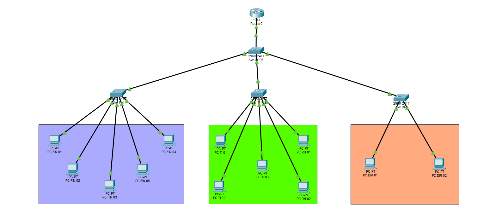
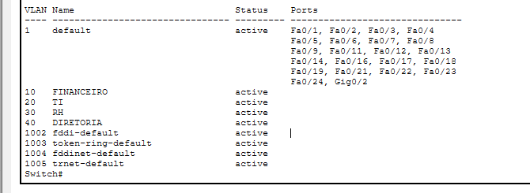
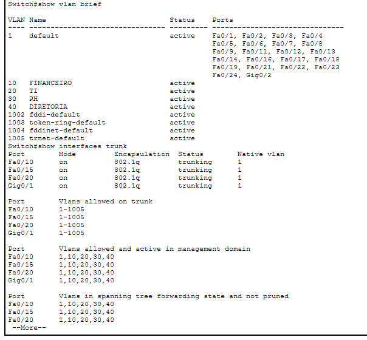
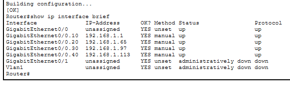
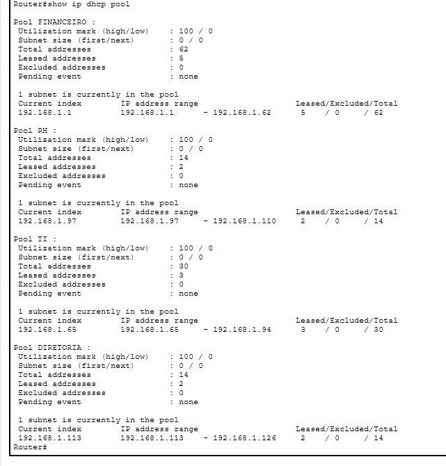
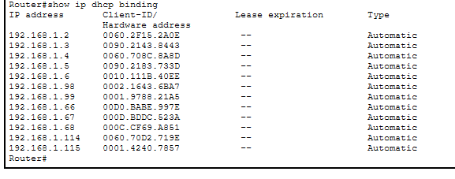
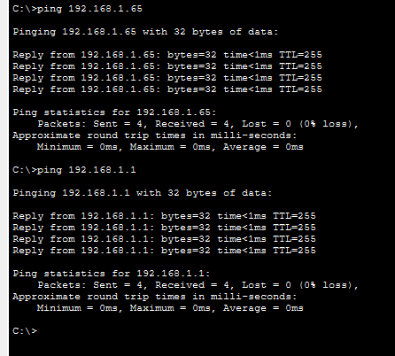

<div align="center">


</div>


## 📌 Sobre o projeto

Projeto de infraestrutura de rede corporativa desenvolvido utilizando o **Cisco Packet Tracer**.

O cenário representa a empresa fictícia **TechStart**, que precisava melhorar sua organização de rede através da separação dos departamentos, controle de endereçamento IP e comunicação eficiente entre os dispositivos.

Foram aplicados conceitos fundamentais de redes como **VLANs, Trunk, VLSM, Router-on-a-Stick e DHCP**.


## 🎯 Objetivos do projeto

- Separar departamentos utilizando VLANs.
- Organizar o endereçamento IP utilizando VLSM.
- Permitir comunicação entre diferentes VLANs.
- Automatizar a configuração dos dispositivos através do DHCP.
- Validar o funcionamento da rede através de testes de conectividade.


## 🛠️ Ferramenta utilizada


## 🌐 Conceitos aplicados

### VLAN (Virtual Local Area Network)

VLANs permitem dividir uma rede física em redes lógicas independentes.

Neste projeto, cada departamento recebeu uma VLAN própria, melhorando a organização e reduzindo o tráfego de broadcast.

| 🧩 VLAN | 🏢 Departamento |
|:--------|:----------------|
| VLAN 10 | Financeiro |
| VLAN 20 | TI |
| VLAN 30 | RH |
| VLAN 40 | Diretoria |

---

### Trunk (802.1Q)

O Trunk permite transportar múltiplas VLANs através de um único link entre equipamentos de rede.

Foi utilizado para permitir que os switches e o roteador trocassem informações de todas as VLANs.

---

### VLSM (Variable Length Subnet Mask)

O VLSM permite criar sub-redes de tamanhos diferentes conforme a necessidade de cada departamento, evitando desperdício de endereços IP.

Rede inicial:

`192.168.1.0/24`

Planejamento:

| 🧩 VLAN | 🏢 Departamento | 🌐 Rede | 🎭 Máscara | CIDR | 🚪 Gateway | 💻 Hosts Utilizáveis | 📣 Broadcast |
|:--------|:----------------|:--------|:-----------|:-----|:-----------|:---------------------|:-------------|
| VLAN 10 | Financeiro | 192.168.1.0 | 255.255.255.192 | /26 | 192.168.1.1 | 192.168.1.1 - 192.168.1.62 | 192.168.1.63 |
| VLAN 20 | TI | 192.168.1.64 | 255.255.255.224 | /27 | 192.168.1.65 | 192.168.1.65 - 192.168.1.94 | 192.168.1.95 |
| VLAN 30 | RH | 192.168.1.96 | 255.255.255.240 | /28 | 192.168.1.97 | 192.168.1.97 - 192.168.1.110 | 192.168.1.111 |
| VLAN 40 | Diretoria | 192.168.1.112 | 255.255.255.240 | /28 | 192.168.1.113 | 192.168.1.113 - 192.168.1.126 | 192.168.1.127 |

---

### Router-on-a-Stick

O Router-on-a-Stick permite que um único roteador realize a comunicação entre VLANs utilizando subinterfaces.

Cada subinterface representa o gateway de uma VLAN.

---

### DHCP (Dynamic Host Configuration Protocol)

O DHCP permite que os computadores recebam automaticamente:

- Endereço IP.
- Máscara de rede.
- Gateway.
- Configurações necessárias para comunicação.

Neste projeto, o roteador foi configurado como servidor DHCP.


## 🏢 Estrutura da rede

| 🧩 VLAN | 🏢 Departamento | 💻 Quantidade de hosts |
|:--------|:----------------|:-----------------------|
| VLAN 10 | Financeiro | 50 |
| VLAN 20 | TI | 20 |
| VLAN 30 | RH | 10 |
| VLAN 40 | Diretoria | 5 |


## 📡 Topologia da rede




## ⚙️ Configurações realizadas

### 1. Criação das VLANs

As VLANs foram criadas nos switches para separar os departamentos.

Comandos utilizados:

```text
enable
configure terminal

vlan 10
name FINANCEIRO

vlan 20
name TI

vlan 30
name RH

vlan 40
name DIRETORIA

end
```

Verificação:

```text
show vlan brief
```

Resultado:



---

### 2. Configuração dos links Trunk

Os links Trunk foram configurados para permitir a passagem das VLANs entre os equipamentos.

Comando utilizado:

```text
interface fastEthernet 0/10

switchport mode trunk
```

Verificação:

```text
show interfaces trunk
```

Resultado:



---

### 3. Configuração do Router-on-a-Stick

Foram criadas subinterfaces no roteador para cada VLAN.

#### VLAN 10

```text
interface gigabitEthernet 0/0.10

encapsulation dot1Q 10

ip address 192.168.1.1 255.255.255.192
```

#### VLAN 20

```text
interface gigabitEthernet 0/0.20

encapsulation dot1Q 20

ip address 192.168.1.65 255.255.255.224
```

#### VLAN 30

```text
interface gigabitEthernet 0/0.30

encapsulation dot1Q 30

ip address 192.168.1.97 255.255.255.240
```

#### VLAN 40

```text
interface gigabitEthernet 0/0.40

encapsulation dot1Q 40

ip address 192.168.1.113 255.255.255.240
```

Verificação:

```text
show ip interface brief
```

Resultado:



---

### 4. Configuração DHCP

O roteador foi configurado como servidor DHCP para distribuir IPs automaticamente.

#### Pool Financeiro

```text
ip dhcp pool FINANCEIRO

network 192.168.1.0 255.255.255.192

default-router 192.168.1.1
```

#### Pool TI

```text
ip dhcp pool TI

network 192.168.1.64 255.255.255.224

default-router 192.168.1.65
```

#### Pool RH

```text
ip dhcp pool RH

network 192.168.1.96 255.255.255.240

default-router 192.168.1.97
```

#### Pool Diretoria

```text
ip dhcp pool DIRETORIA

network 192.168.1.112 255.255.255.240

default-router 192.168.1.113
```

Verificação dos pools:

```text
show ip dhcp pool
```



Verificação dos IPs entregues:

```text
show ip dhcp binding
```




## 🧪 Testes de conectividade

Foram realizados testes utilizando o comando:

```text
ping
```

Exemplo:

```text
ping 192.168.1.65
```

Teste entre VLANs:

```text
ping 192.168.1.1
```

Resultado:




## ⌨️ Principais comandos Cisco utilizados

### 🔹 Comandos básicos do Cisco IOS

Comandos utilizados para acessar os modos de configuração dos equipamentos.

**enable**

Entra no modo privilegiado do equipamento, permitindo executar comandos administrativos.

Exemplo:

```text
enable
```

---

**configure terminal**

Acessa o modo de configuração global, onde são realizadas alterações no equipamento.

Exemplo:

```text
configure terminal
```

---

**hostname**

Altera o nome do equipamento para facilitar sua identificação na rede.

Exemplo:

```text
hostname R1
```

---

### 🔹 Configuração de VLANs

Comandos utilizados para criar, nomear e verificar as VLANs responsáveis pela separação dos departamentos.

**vlan**

Cria uma VLAN no switch.

Exemplo:

```text
vlan 10
```

Neste projeto:

* VLAN 10 → Financeiro
* VLAN 20 → TI
* VLAN 30 → RH
* VLAN 40 → Diretoria

---

**name**

Define um nome para a VLAN criada.

Exemplo:

```text
vlan 10
name FINANCEIRO
```

---

**show vlan brief**

Exibe as VLANs existentes no switch e suas portas associadas.

Exemplo:

```text
show vlan brief
```

Utilizado para verificar se as VLANs foram criadas corretamente.

---

### 🔹 Configuração das portas do switch

Comandos utilizados para definir o funcionamento das interfaces do switch.

**interface**

Seleciona uma interface específica para configuração.

Exemplo:

```text
interface fastEthernet 0/1
```

---

**switchport mode access**

Configura uma porta como access, utilizada para conectar dispositivos finais.

Exemplo:

```text
switchport mode access
```

---

**switchport access vlan**

Associa uma porta específica a uma VLAN.

Exemplo:

```text
switchport access vlan 10
```

O dispositivo conectado nessa porta fará parte da VLAN 10.

---

### 🔹 Configuração de Trunk

Comandos utilizados para permitir o transporte de múltiplas VLANs entre equipamentos de rede.

**switchport mode trunk**

Configura uma interface para operar como trunk.

Exemplo:

```text
interface fastEthernet 0/10
switchport mode trunk
```

---

**show interfaces trunk**

Mostra as interfaces configuradas como trunk e as VLANs permitidas.

Exemplo:

```text
show interfaces trunk
```

---

### 🔹 Router-on-a-Stick

Comandos utilizados para configurar o roteamento entre VLANs através do roteador.

**interface gigabitEthernet**

Seleciona uma interface do roteador ou uma subinterface.

Exemplo:

```text
interface gigabitEthernet 0/0.10
```

---

**encapsulation dot1Q**

Associa uma subinterface a uma VLAN utilizando o protocolo 802.1Q.

Exemplo:

```text
encapsulation dot1Q 10
```

---

**ip address**

Configura o endereço IP da interface, utilizado como gateway da VLAN.

Exemplo:

```text
ip address 192.168.1.1 255.255.255.192
```

---

**show ip interface brief**

Exibe as interfaces do roteador, seus endereços IP e status.

Exemplo:

```text
show ip interface brief
```

---

### 🔹 Configuração DHCP

Comandos utilizados para configurar o roteador como servidor DHCP.

**ip dhcp pool**

Cria um pool de endereços IP para distribuição automática.

Exemplo:

```text
ip dhcp pool FINANCEIRO
```

---

**network**

Define a rede que será distribuída pelo DHCP.

Exemplo:

```text
network 192.168.1.0 255.255.255.192
```

---

**default-router**

Define o gateway que será entregue aos dispositivos.

Exemplo:

```text
default-router 192.168.1.1
```

---

**show ip dhcp binding**

Mostra os endereços IP entregues pelo servidor DHCP.

Exemplo:

```text
show ip dhcp binding
```

---

### 🔹 Testes e troubleshooting

Comandos utilizados para validar o funcionamento da rede e analisar possíveis problemas.

**ping**

Testa a comunicação entre dispositivos utilizando ICMP.

Exemplo:

```text
ping 192.168.1.65
```

---

**show running-config**

Exibe a configuração atual do equipamento.

Exemplo:

```text
show running-config
```

---

**copy running-config startup-config**

Salva as configurações atuais para que elas permaneçam após reiniciar o equipamento.

Exemplo:

```text
copy running-config startup-config
```


## 📋 Resumo dos comandos

| ⌨️ Comando | 📖 Função |
|:-----------|:----------|
| `show vlan brief` | Verificar VLANs configuradas |
| `show interfaces trunk` | Verificar links trunk |
| `show ip interface brief` | Verificar interfaces IP |
| `show ip dhcp binding` | Verificar IPs entregues pelo DHCP |
| `ping` | Testar conectividade |
| `show running-config` | Visualizar configurações atuais |
| `copy running-config startup-config` | Salvar configurações |


## 📚 Conhecimentos desenvolvidos

Durante o projeto foram praticados:

- ✅ Configuração de equipamentos Cisco.
- ✅ Criação e gerenciamento de VLANs.
- ✅ Configuração de links Trunk.
- ✅ Endereçamento IPv4.
- ✅ Subnetting e VLSM.
- ✅ Roteamento entre VLANs.
- ✅ Configuração de DHCP.
- ✅ Troubleshooting utilizando comandos Cisco.


<div align="center">

## ✅ Status do projeto

### 🟢 Concluído


## 👨‍💻 Autor

**Pablo Gonçalves Santos**

Estudante de Sistemas de Informação com foco em Cibersegurança.

<br/>

[](https://github.com/pablogsantoscontato-ops)

<br/>

<sub>Desenvolvido com ❤️ para o aprendizado de redes</sub>


</div>
